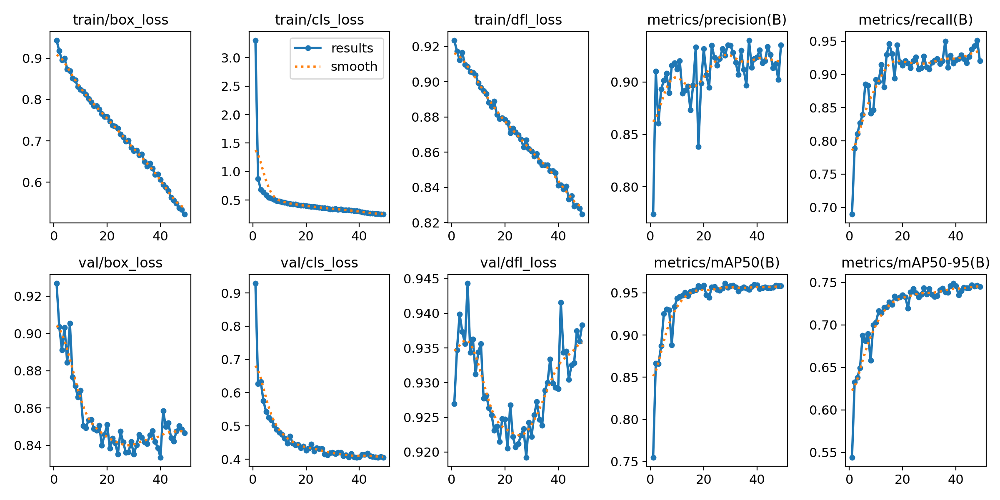

# Robotaksi Trafik İşareti Algılama

Otonom bir araç için kamera görüntüsünden **19 sınıf trafik levhası ve trafik ışığını** gerçek zamanlı tespit eden YOLOv8 tabanlı bir nesne tespit modeli. Doğrulama setinde **%96,0 mAP@0.5** ve **%74,9 mAP@0.5:0.95** sonucuna ulaştı.

Proje, Teknofest Robotaksi yarışmasına hazırlık sürecinde başladı. Bu depo, aracın benim geliştirdiğim trafik işareti algılama modülünü içerir.

## Sonuçlar

Model: YOLOv8s · Doğrulama seti: 482 görüntü · En iyi ağırlıklar: 39. epoch

| Metrik | Değer |
| --- | --- |
| mAP@0.5 | **0,960** |
| mAP@0.5:0.95 | **0,749** |
| Precision | 0,922 |
| Recall | 0,916 |



Epoch bazında tüm değerler [`results/results.csv`](results/results.csv) dosyasında.

## Neler yaptım

1. **Veri seti seçimi:** Roboflow Universe'teki 3 açık veri setini (10, 14 ve 19 sınıflı) kısa deneme eğitimleriyle karşılaştırdım. Yarışma parkurundaki Türkçe levhaları ve trafik ışıklarını içeren 19 sınıflı seti seçtim.
2. **Model denemeleri:** Önce YOLOv8n ile yaklaşık 20 kısa deneme eğitimi yaptım. Ardından daha yüksek doğruluk için YOLOv8s'e geçtim.
3. **Eğitim:** Modeli RTX 4060 (8 GB) GPU üzerinde 640 px, batch 32 ve erken durdurma (patience 10) ile 50 epoch eğittim. Eğitim yaklaşık 2,9 saat sürdü.
4. **Test:** Modeli OpenCV ile parkur videosu üzerinde kare kare çalıştırdım. Güven eşiğini 0,70'e çekerek yanlış tespitleri azalttım.

## Sınıflar

| Levhalar | | Işıklar ve park |
| --- | --- | --- |
| donel_kavsak | ileriden_saga | lamba_kirmizi |
| durak | ileriden_sola | lamba_sari |
| gidis_donus | sag_mecburi | lamba_yesil |
| girisi_olmayan_yol | sol_mecburi | park_edilebilir |
| ileri_mecburi | saga_donulmez | park_engelli |
| ileri_sag_mecburi | sola_donulmez | park_yasak |
| ileri_sol_mecburi | | |

## Kurulum ve kullanım

```bash
git clone https://github.com/mertyuksekdev/robotaksi-trafik-isareti-tespiti.git
cd robotaksi-trafik-isareti-tespiti
pip install -r requirements.txt
```

**Veri seti:** [parkur v7](https://universe.roboflow.com/minaws-ttilh/parkur-ilbm7/dataset/7) setini Roboflow'dan *YOLOv8* formatında indirin ve `datasets/parkur` klasörüne çıkarın.

**Eğitim:**

```bash
python train.py                      # README'deki sonuçların ayarları
python train.py --batch 16           # GPU belleği yetmezse
```

**Video ya da kamera üzerinde tespit** (ekranda anlık FPS gösterilir):

```bash
python detect.py --weights runs/robotaksi/weights/best.pt --source parkur.mp4
python detect.py --weights runs/robotaksi/weights/best.pt --source 0
```

## Proje yapısı

```
├── data.yaml          # Veri seti yolları ve 19 sınıf
├── train.py           # Eğitim
├── detect.py          # Video / kamera üzerinde tespit + FPS ölçümü
├── requirements.txt
├── assets/results.png # Eğitim eğrileri
└── results/results.csv
```

## Geliştirme fikirleri

- Parkurdan kendi görüntülerimi toplayıp etiketleyerek veri setini genişletmek
- YOLOv8s ile YOLOv8n arasındaki hız/doğruluk farkını Jetson gibi gömülü bir donanımda ölçmek
- Modeli TensorRT ya da ONNX'e aktararak çıkarım hızını artırmak

## Kaynaklar ve lisans

- Veri seti: *parkur* v7, Roboflow Universe kullanıcısı **minaws-ttilh**, [CC BY 4.0](https://creativecommons.org/licenses/by/4.0/). Veri seti bu depoda bulunmaz.
- Model: [Ultralytics YOLOv8](https://github.com/ultralytics/ultralytics) (AGPL-3.0)
- Bu depodaki kod: [MIT](LICENSE)

---

**Mert Melih Yüksek** · Tarsus Üniversitesi Bilgisayar Mühendisliği · [LinkedIn](https://www.linkedin.com/in/mert-melih-yuksek-12719338b/)
